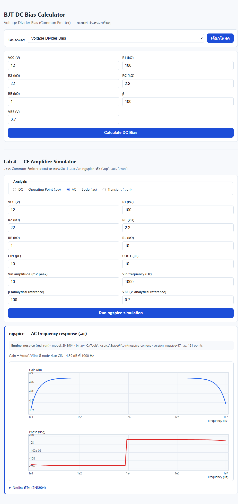
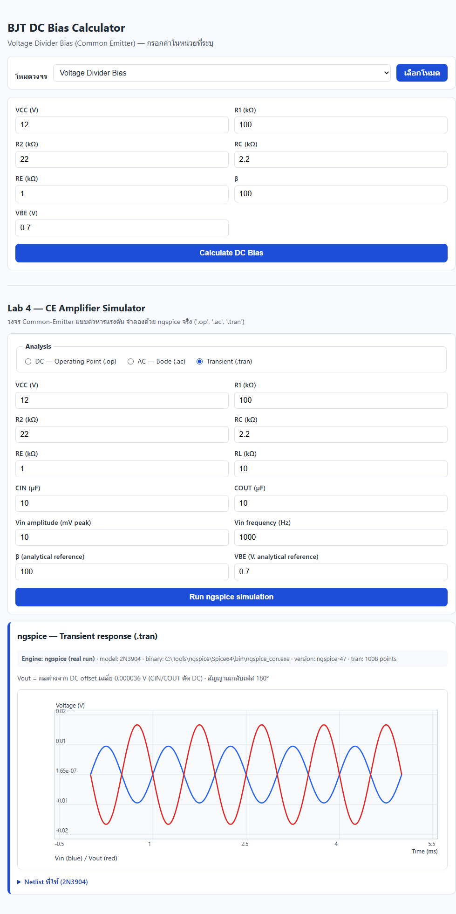

# BJT DC Bias Web App

เครื่องมือคำนวณ DC Operating Point ของวงจร BJT Common Emitter (วิชา ENG29 2121) — **Lab 03** รองรับสามวงจรไบอัส และ **Lab 04** จำลองเครื่องขยาย CE ด้วย ngspice จริง

| โหมด | ช่องอินพุตเพิ่ม | สูตรกระแสฐาน |
|---|---|---|
| Voltage Divider Bias (Lab 02) | R1, R2, RE | `(VTH − VBE) / [RTH + (β+1)RE]` |
| Fixed Bias | RB | `(VCC − VBE) / RB` |
| Emitter Bias (แหล่งจ่ายเดียว) | RB, RE | `(VCC − VBE) / [RB + (β+1)RE]` |

ทุกโหมดได้ `VB, VE, VC, VCE, IC, IB, IE` พร้อมหน่วย, Operating Region และคำเตือนเมื่อแบบจำลอง Forward-Active ใช้ไม่ได้ — คำนวณจริงด้วย Python/Flask ไม่ใช่ตัวเลขฮาร์ดโค้ด

## ความต้องการระบบ

- Python 3.x (พัฒนาบน Python 3.15.2)
- Flask 3.1.3 (ติดตั้งผ่าน `requirements.txt`)
- **ngspice 47** (สำหรับ Lab 04) — บน Windows ใช้ `ngspice_con.exe` (ตัว `ngspice.exe` เป็น GUI และ detach ทันทีใน batch mode)

ติดตั้ง portable (ไม่ต้อง admin/reboot):

1. โหลด `ngspice-47_64.7z` จาก <https://sourceforge.net/projects/ngspice/files/ng-spice-rework/47/>
2. แตกเป็นเช่น `C:\Tools\ngspice` → binary คือ `C:\Tools\ngspice\Spice64\bin\ngspice_con.exe`
3. ถ้า binary อยู่ที่อื่น ตั้ง env `NGSPICE_BIN` ให้ชี้ถึง `\path\to\ngspice_con.exe`

ลำดับค้นหา: `NGSPICE_BIN` → `ngspice_con` ใน PATH → `ngspice` ใน PATH (จะเลือก `ngspice_con.exe` ข้าง ๆ ถ้ามี) → `C:\Tools\ngspice\Spice64\bin\ngspice_con.exe`

## ติดตั้งและรัน

```bash
# 1. clone แล้วเข้าโฟลเดอร์โปรเจกต์
python -m venv .venv

# เปิด virtual environment:
#   Windows:        .venv\Scripts\Activate.ps1
#   Linux/macOS:    source .venv/bin/activate

python -m pip install -r requirements.txt

# 2. รันเว็บเซิร์ฟเวอร์
python -m flask --app app run --debug
```

เปิดเบราว์เซอร์ที่ `http://127.0.0.1:5000/`

- `http://127.0.0.1:5000/` — Voltage Divider Bias (ค่าเริ่มต้น)
- `http://127.0.0.1:5000/?mode=fixed` — Fixed Bias
- `http://127.0.0.1:5000/?mode=emitter` — Emitter Bias

สลับโหมดได้จาก dropdown บนหน้าเว็บ (โหลดฟอร์มใหม่เฉพาะช่องที่โหมดนั้นใช้ ไม่ต้องใช้ JavaScript)

### Lab 04 — CE Amplifier Simulator

ที่ด้านล่างของหน้าเดียวกัน เลือก `DC (.op)` / `AC (.ac)` / `Transient (.tran)` แล้วกด **Run ngspice simulation** — ผลที่แสดงมาจากการรัน ngspice จริงทุกครั้ง ไม่ใช่ค่าฮาร์ดโค้ด

- หน่วยในฟอร์ม: V, kΩ, µF, mV peak, Hz — แปลงเป็น SI ก่อนเรียก engine
- ผล DC: VB, VE, VC, VCE, IC, IB พร้อมชื่อโมเดล 2N3904, path binary, version และ netlist ที่ใช้จริง
- ผล AC: กราฟ Bode (gain dB / phase deg vs log Hz) จาก 121 จุด (10 Hz–10 MHz)
- ผล Tran: กราฟ Vin/Vout vs time (ms) จาก `.tran` ที่ step = period/200, stop = min(max(5 periods, 5 ms), 50 ms)
- ตาราง **Analytical reference (dc_bias.py)** แยกต่างหาก — โมเดล β/VBE ไม่ใช่ SPICE model จึงไม่ต้องตรงกัน
- ถ้า engine ผิดพลาด หน้าจะแสดงข้อความไทยและ **ไม่มีกราฟ/ค่าค้างจากรอบก่อน** (HTTP 200 เสมอ)

กราฟเป็น **inline SVG ที่สร้างตอนกด Run** จึงไม่มีไฟล์ `.png` แยกในหน้าเว็บ — ภาพด้านล่างเป็น screenshot ของผลที่รันจริง (เก็บไว้ใน `docs/captures/`):

| AC — Bode (gain/phase) | Transient — Vin/Vout |
|---|---|
|  |  |

> ต้องรันผ่าน Local Web Server เท่านั้น — ห้ามเปิดไฟล์ HTML ด้วย `file://`

## รัน automated tests

```bash
python -m unittest discover -s tests -v
```

- `tests/test_dc_bias.py` — สมการและ validation ของทั้งสามโหมด
- `tests/test_web.py` — Flask HTTP tests (`GET /`, `POST /calculate` ทุกโหมด รวมโหมดผิดและอินพุตผิด, `POST /simulate` ทุก analysis และ error path)
- `tests/test_spice_engine.py` — netlist, parser, runner, `simulate()` + real-binary smoke test
- `tests/test_spice_plots.py` — SVG geometry helpers

ในเครื่องที่ไม่มี ngspice ชุดเทสต์จะ **skip** integration test ตัวเดียว (`TestRealNgspice`) แต่เทสต์อื่นยังผ่านด้วย fixture จริงที่เก็บใน `tests/fixtures/`

## โครงสร้างโปรเจกต์

```
app.py                 # Flask routes (HTTP layer เท่านั้น) + /calculate + /simulate
dc_bias.py             # สมการ + validation ล้วน ๆ ไม่รู้จัก Flask/HTTP
spice_engine.py        # adapter ngspice ล้วน ๆ ไม่รู้จัก Flask/HTML
spice_plots.py         # pure helpers แปลง series → SVG string
templates/index.html   # Lab 3 ฟอร์ม/ตารางผล + Lab 4 ฟอร์ม/กราฟ (Jinja)
static/style.css       # styles responsive
tests/                 # unittest suite + fixtures จาก ngspice จริง
docs/                  # design note, validation evidence (A1–A5), plan, spec
requirements.txt       # Flask==3.1.3 (pin)
```

## หน่วย

- ตัวต้านทานกรอกเป็น **kΩ** (เช่น 100, 2.2, 1000 = 1 MΩ) — แปลงเป็น Ω ใน backend จุดเดียว
- แรงดันกรอกเป็น **V**; ผลลัพธ์: แรงดัน V, IC/IE เป็น mA, IB เป็น µA
- ฟอร์ม Lab 04: C เป็น **µF**, Vin เป็น **mV peak**, frequency เป็น **Hz**; engine ได้ Ω/F/V/Hz (SI)

## ข้อจำกัด

แบบจำลองคำนวณเป็น Forward-Active — เมื่อ `IB ≤ 0` (Cutoff) หรือ `VCE < 0.2 V` (Saturation) หน้าเว็บจะแสดงคำเตือนว่าค่าที่แสดงเชื่อถือไม่ได้

## การตรวจรับ Lab 03

ตาราง A1–A5 พร้อมค่าอ้างอิงอิสระ ผลจริงจากเบราว์เซอร์ และหลักฐานภาพ: [`docs/validation.md`](docs/validation.md)

- A1 (Divider ด้วยค่าเดิม) ให้ผลเท่า Lab 02: IC = 1.230 mA, VCE = 8.052 V
- A2 (Fixed RB = 1 MΩ): IC = 1.130 mA, VCE = 9.514 V
- A3 (Emitter RB = 1 MΩ, RE = 1 kΩ): IC = 1.026 mA, VCE = 8.705 V
- A4 (Emitter RE = 2 kΩ): IC = 0.940 mA (ลดลง), VCE = 8.033 V
- A5 (Fixed RB = 0): แสดง `RB, RC ต้องมากกว่า 0` ไม่มีผลค้าง และ HTTP 200

## GitHub และ Commit

- Repository: <https://github.com/p0ngphop255021-crypto/BJT-DC-Bias-Web-App>
- Commit SHA ของงาน Lab 03 (โค้ด + การตรวจรับ A1–A5): `2e88fed` (commit เอกสารตามหลังอาจใหม่กว่านี้)
- งาน Lab 04 อยู่บน branch `feat/lab04-simulator` (push แล้ว) — ดู SHA ล่าสุดได้จาก `git log -1`

## เส้นทางข้อมูล (ตรวจย้อนกลับได้)

1. ฟอร์มส่ง `mode` + ค่าดิบ (ตัวต้านทานเป็น kΩ) ไป `POST /calculate`
2. `app.py::_parse_form` แปลงเฉพาะช่องของโหมดนั้นเป็น float แล้วคูณ 1000 เป็น Ω
3. `app.py::_solve_for_mode` เลือก `dc_bias.solve` / `solve_fixed` / `solve_emitter` ตาม `mode`
4. ฟังก์ชันใน `dc_bias.py` คำนวณเป็น SI (Ω, V, A) แล้วคืน `dict`
5. `templates/index.html` แปลงหน่วยแสดงผลเป็น mA/µA และแสดง warning ที่ route ส่งมา (ไม่มีสมการใน template)

## ส่วนที่ AI ช่วย และส่วนที่นักศึกษาตรวจ

- AI ช่วย: ร่างฟังก์ชัน `solve_fixed` / `solve_emitter`, การเลือกฟังก์ชันตามโหมดใน `app.py`, ฟอร์ม/สไตล์, ชุดเทสต์ และเอกสาร
- นักศึกษาตรวจ: สมการและหน่วยของทั้งสามโหมด, การแปลง kΩ→Ω, การเลือกฟังก์ชันตามโหมด, เงื่อนไข validation และการแสดง warning, และทวนผล A1–A5 บนเบราว์เซอร์ด้วยค่าอ้างอิงที่คำนวณเอง
